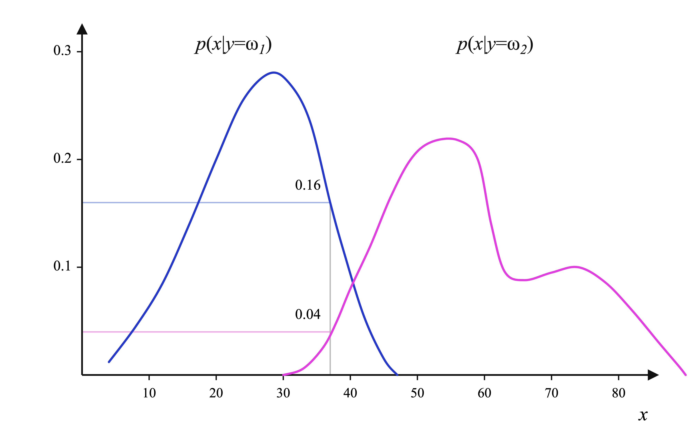
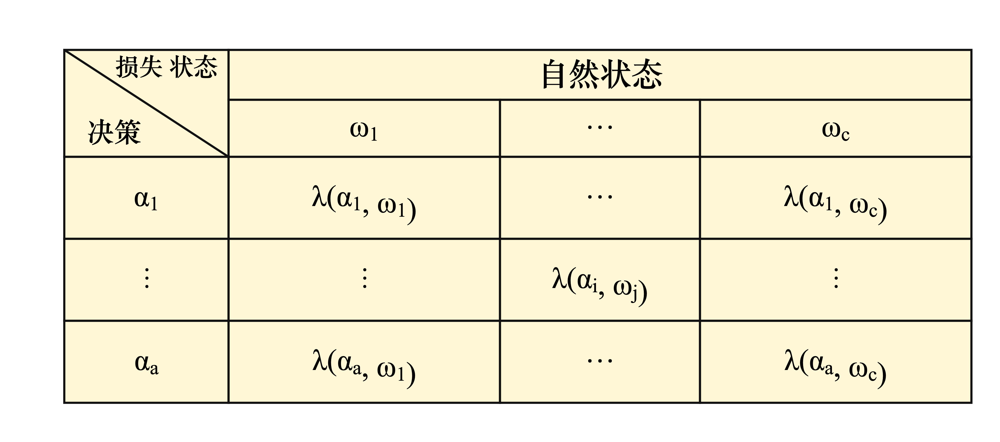

## 贝叶斯决策

贝叶斯决策分为两步：

+ 算出不同猜测的可能性大小，也就是计算后验概率
+ 根绝准则决定最可靠的策略

后验概率
$$
P(\theta \mid D) = \frac{P(D \mid \theta)\, P(\theta)}{P(D)}
$$

+ $D$ 一般是连续变量
+ $\theta$ 离散变量，可以认为是类别
+ $P(\theta) $ 先验概率，依据大量统计数据确定确定某类事物出现的比例
+ $P(X|\omega)$ 类条件概率密度，同一事物的各个属性有一定的变化范围，在这些变化范围内的分布密度用一种函数形式表示
  + 
  + $P(x=38|y=)w_1=0.16$

### 决策规则

1. **基于最小错误概率的贝叶斯决策**，选择**后验概率**最大的类别，因为依赖于先验概率所以是不确定性推理
   1. $$P(\omega_i \mid x) = \max_j\left[P(\omega_j \mid x)\right] \;\Rightarrow\; x \in \omega_i \quad \text{（后验概率形式）}$$
   2. $$P(x \mid \omega_i)\,P(\omega_i) > P(x \mid \omega_j)\,P(\omega_j), \quad \forall j \neq i \;\Rightarrow\; x \in \omega_i \quad \text{（条件概率形式）}$$
   3. $$\frac{P(x \mid \omega_i)}{P(x \mid \omega_j)} > \frac{P(\omega_j)}{P(\omega_i)}, \quad \forall j \neq i \;\Rightarrow\; x \in \omega_i \quad \text{（似然比形式）}$$
   4. $$\ln P(x \mid \omega_i) + \ln P(\omega_i) > \ln P(x \mid \omega_j) + \ln P(\omega_j), \quad \forall j \neq i \;\Rightarrow\; x \in \omega_i$$ 
2. **最小风险贝叶斯决策**，考虑到各种错误造成的损失不同，找到条件风险最小的动作 
   1. 决策表，损失函数$\lambda(\alpha_i,\omega_j)$表示真实状态为$\omega_j$而所采取的决策为$\alpha_i$时所带来的损失（将属于$\omega_j$样本归类到了$i$） 
   2. 条件风险（条件期望损失）$R(\alpha_i \mid x) = E\left[\lambda(\alpha_i,\omega_j)\right]
      = \sum_{j=1}^{c}\lambda(\alpha_i,\omega_j)\,P(\omega_j \mid x),
      \quad i = 1,2,\ldots,a$  
   3. 两分类问题可以推导得到$\begin{aligned} R(\alpha_1 \mid x) &= \lambda_{11}P(\omega_1 \mid x) + \lambda_{12}P(\omega_2 \mid x) \\ R(\alpha_2 \mid x) &= \lambda_{21}P(\omega_1 \mid x) + \lambda_{22}P(\omega_2 \mid x) \end{aligned}$​，再转换一步有$\frac{p(x \mid w_1)}{p(x \mid w_2)} >
      \frac{(\lambda_{12}-\lambda_{22})\,P(w_2)}
           {(\lambda_{21}-\lambda_{11})\,P(w_1)}$
   4. 当损失函数为0-1损失时，即$\begin{cases} 0, & \text{for } i = j \\[4pt] 1, & \text{for } i \neq j \end{cases}, \qquad i,j = 1,\cdots,c$， 最小风险决策和最小错误率决策等价

 ### 判别函数

决策域：待识别的特征向量落在哪个决策域，样本就被判为哪一类

决策面：决策域的边界面就是决策面（一维点，二维线，三维面）

判别函数：用于表达决策规则的函数，后验概率和条件风险都 是一种判别函数

两类的情况下，判别函数可以定义为
$$
\begin{aligned}
①\quad g(x) &= P(\omega_1 \mid x) - P(\omega_2 \mid x) \\[6pt]
②\quad g(x) &= p(x \mid \omega_1)P(\omega_1) - p(x \mid \omega_2)P(\omega_2) \\[6pt]
③\quad g(x) &= \ln\frac{p(x \mid \omega_1)}{p(x \mid \omega_2)}
               - \ln\frac{P(\omega_2)}{P(\omega_1)}
\end{aligned}
$$
决策面方程 g(x)=0，可为$P(\omega_1 \mid x) - P(\omega_2 \mid x) = 0$

### 正态分布下的决策

假定类条件概率密度的分布是正态分布 
$$
\begin{aligned}
p(x) &= \frac{1}{\sqrt{2\pi}\,\sigma}\,
        e^{-\frac{(x-\mu)^2}{2\sigma^2}},
        \quad \text{记做 } N(\mu,\sigma^2) \\[8pt]
\mu &= E\{x\} = \int_{-\infty}^{+\infty} x\,p(x)\,dx, \\
\sigma^2 &= \int_{-\infty}^{+\infty} (x-\mu)^2\,p(x)\,dx
\end{aligned}
$$

$$
\begin{aligned}
\mathbf{x} &= [x_1,\ldots,x_d]^{T} \\[6pt]
p(\mathbf{x}) &= \frac{1}{(2\pi)^{d/2}\,|\Sigma|^{1/2}}\,
                 e^{-\frac{1}{2}(\mathbf{x}-\boldsymbol{\mu})^{T}
                    \Sigma^{-1}(\mathbf{x}-\boldsymbol{\mu})} \\[6pt]
\text{期望（均值向量）：}\quad
\boldsymbol{\mu} &= E\{\mathbf{x}\} = [\mu_1,\mu_2,\cdots,\mu_d]^{T} \\[6pt]
\end{aligned}
$$ {\begin{aligned}

判别函数为
$$
\begin{aligned}
g_i(\mathbf{x}) &= \ln p(\mathbf{x}\mid\omega_i) + \ln P(\omega_i) \\[8pt]
g_i(\mathbf{x}) &= -\frac{1}{2}(\mathbf{x}-\boldsymbol{\mu}_i)^{T}
                    \Sigma_i^{-1}(\mathbf{x}-\boldsymbol{\mu}_i)
                  -\frac{d}{2}\ln 2\pi
                  -\frac{1}{2}\ln|\Sigma_i|
                  +\ln P(\omega_i)
\end{aligned}
$$
决策面方程为
$$
-\frac{1}{2}\left[
(\mathbf{x}-\boldsymbol{\mu}_i)^{T}\Sigma_i^{-1}(\mathbf{x}-\boldsymbol{\mu}_i)
-(\mathbf{x}-\boldsymbol{\mu}_j)^{T}\Sigma_j^{-1}(\mathbf{x}-\boldsymbol{\mu}_j)
\right]
-\frac{1}{2}\ln\frac{|\Sigma_i|}{|\Sigma_j|}
+\ln\frac{P(\omega_i)}{P(\omega_j)}
= 0
$$
