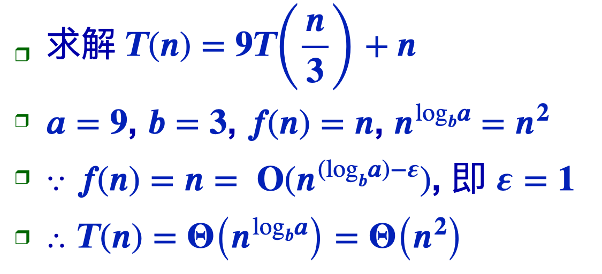
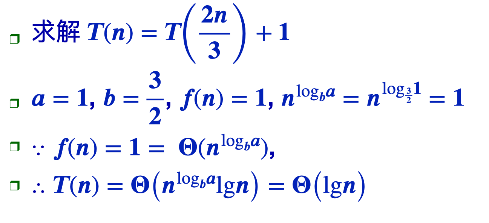
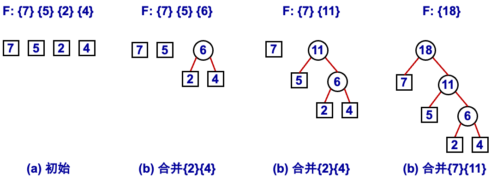
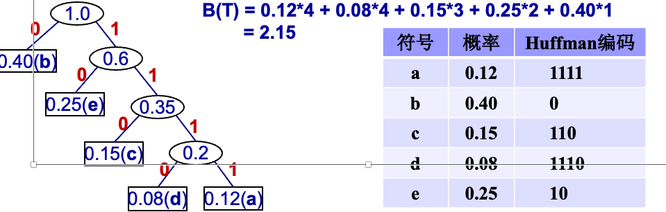
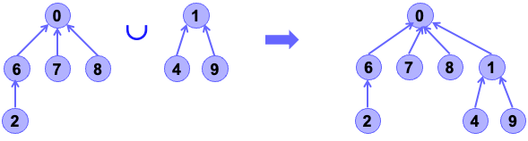
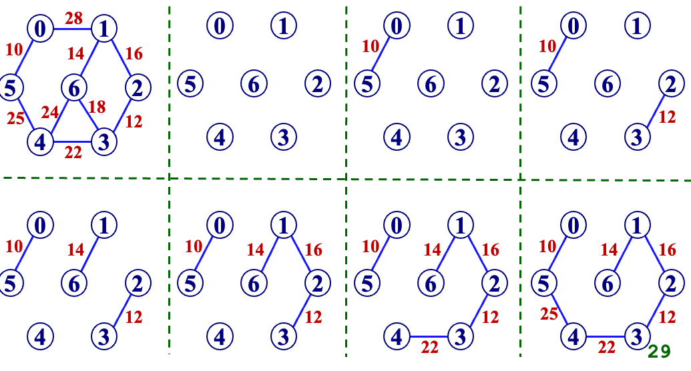

# 算法分析与设计

## 一、主定理（Master Theorem）

用于求解递归式的时间复杂度：

$$
T(n)=a\cdot T(n/b)+f(n),\qquad a\ge 1,\ b>1
$$

其中 $a\ge1$、$b>1$ 是常数，$f(n)$ 是正函数。比较 $f(n)$ 与 $n^{\log_b a}$ 的阶，分三种情况。

### 情况 1

$$
f(n)=O\left(n^{\log_b a-\varepsilon}\right),\qquad \varepsilon>0
$$

则有

$$
T(n)=\Theta\left(n^{\log_b a}\right)
$$

### 情况 2

$$
f(n)=\Theta\left(n^{\log_b a}\right)
$$

则有

$$
T(n)=\Theta\left(n^{\log_b a}\log n\right)
$$

### 情况 3

$$
f(n)=\Omega\left(n^{\log_b a+\varepsilon}\right),\qquad \varepsilon>0
$$

且存在常数 $c<1$，使所有充分大的 $n$ 满足

$$
a\,f(n/b)\le c\,f(n)
$$

则有

$$
T(n)=\Theta\big(f(n)\big)
$$

三种情况的直观对比：






## 二、分治算法

### 大整数乘法

将一个大整数拆分成两个较小的整数，通过数学变换减少递归乘法的次数。

拆分方式（每个数拆成高、低各 $n/2$ 位）：

```text
        n/2 位      n/2 位
X =  ┌─────────┬─────────┐
     │    A    │    B    │
     └─────────┴─────────┘

        n/2 位      n/2 位
Y =  ┌─────────┬─────────┐
     │    C    │    D    │
     └─────────┴─────────┘
```

直接相乘：

$$
XY=\left(A2^{n/2}+B\right)\left(C2^{n/2}+D\right)
  =AC\,2^n+(AD+BC)\,2^{n/2}+BD
$$

展开后需要 4 次乘法（$AC$、$AD$、$BC$、$BD$），由主定理可得 $T(n)=\Theta(n^2)$，复杂度并没有降低。

利用恒等式把 4 次乘法压缩成 3 次：

$$
AD+BC=(A+B)(C+D)-AC-BD
$$

$$
XY=AC\,2^n+\big[(A+B)(C+D)-AC-BD\big]2^{n/2}+BD
$$

此时只需要计算 3 个规模减半的递归子问题：

$$
T(n)=3T\left(\frac{n}{2}\right)+\Theta(n)
$$

### 矩阵乘法

矩阵运算同理：把大矩阵划分为 4 个 $(n/2)\times(n/2)$ 的子矩阵，经过变换可以把 8 次子矩阵乘法减少为 7 次。

### 堆排序

堆排序的思想：每次把堆顶元素（最大值）与堆中最后一个元素交换（放到列表的最后一个位置），剔除最大元素后，再把剩余部分调整为最大堆。

### 最近点对

问题：在二维平面上的 $n$ 个点中，找到距离最近的两个点。

- 如果点的个数小于 3，可以直接暴力计算；
- 把坐标点分别按 **x 坐标**和 **y 坐标**排序；
- 找出 x 的中位数 $m$；
- 用垂线 $x=m$ 把平面划分成左右两个区域 $L$ 和 $R$；
- 递归地在 $L$、$R$ 中寻找最近点对，令两侧距离的最小值为 $d$；
- 取 $|x-x_{\text{mid}}|<d$ 的带状区域为临界区，该区域内的点是有限的，每个点最多只需比较 7 次。

时间复杂度为 $O(n\log n)$。

### 傅里叶变换

（待补充）

### 寻找凸包

凸包定义为能包裹住 $n$ 个点的凸多边形，且面积最小。（待补充）

### 天际轮廓线

**待复习**：分治解法还没看。

### 两个有序数组的中位数

核心思想都是利用二分查找，每次排除一部分不可能成为中位数的元素。

#### 场景一：两个等长有序数组

题目：给定两个长度均为 $n$ 的有序数组 $X$ 和 $Y$，求这 $2n$ 个数的中位数，要求时间复杂度为 $O(\log n)$。

**基本思想**

分别取两个数组的中间元素：

$$
x=X[\lfloor n/2\rfloor],\qquad y=Y[\lfloor n/2\rfloor]
$$

比较这两个中间元素：

- 如果 $x=y$，它们就是合并后中间位置对应的值；
- 如果 $x<y$，可以排除 $X$ 的较小一半和 $Y$ 的较大一半；
- 如果 $x>y$，可以排除 $X$ 的较大一半和 $Y$ 的较小一半。

每次比较后，问题规模缩小一半。

**算法步骤**

设两个数组长度均为 $n$：

1. 分别计算两个数组的中位数 $x$ 和 $y$；
2. 如果 $x=y$，直接返回结果；
3. 如果 $x<y$，保留 $X$ 的右半部分和 $Y$ 的左半部分；
4. 如果 $x>y$，保留 $X$ 的左半部分和 $Y$ 的右半部分；
5. 重复上述过程，直到剩余元素足够少，直接计算中位数。

时间复杂度：

$$
T(n)=T(n/2)+O(1)
$$

#### 场景二：两个长度不同的有序数组

题目：给定两个有序数组 $X[0:m-1]$ 和 $Y[0:n-1]$，长度不同，要求在 $O(\log(m+n))$ 时间内求出合并后的中位数。

**基本思想：二分划分**

假设两个数组合并后共有

$$
N=m+n
$$

个元素。把两个数组划分为左右两部分：

- 左边包含前 $\lceil N/2\rceil$ 个元素；
- 右边包含剩余元素。

只要「填满左边」即可。填满左边本质上是在 $X$ 和 $Y$ 中各取一些数，设：

- 在数组 $X$ 中取前 $i$ 个元素放入左边；
- 在数组 $Y$ 中取前 $j=\lceil N/2\rceil-i$ 个元素放入左边。

那么必须满足

$$
i+j=\left\lceil\frac{m+n}{2}\right\rceil
$$

要保证左边所有元素都小于右边，需要同时满足：

- $X$ 的左半部分 $X[i-1]\le Y[j]$（$Y$ 的右半部分），不满足说明 $X$ 取多了；
- $Y$ 的左半部分 $Y[j-1]\le X[i]$（$X$ 的右半部分），不满足说明 $X$ 取少了。

对 $i$ 二分，即可在 $O(\log\min(m,n))$ 内定位划分点。

### 最大子数组

题目：给定一个包含 $n$ 个整数（有正有负）的数组 $A$，设计一个 $O(n\log n)$ 的算法，找出和最大的非空连续子数组。

划分后，最优解只有三种位置：

1. 完全落在左半 `A[lo..mid]`；
2. 完全落在右半 `A[mid+1..hi]`；
3. 跨越中点，即形如 `A[i..j]`，其中 `i ≤ mid < j`。

前两种递归求解。第三种可以在 $O(n)$ 时间内直接算出：从 `mid` 往左扫累加，记录最大前缀和 `best_l`；从 `mid+1` 往右扫累加，记录最大后缀和 `best_r`；跨越中点的最优值就是 `best_l + best_r`。注意两侧都必须至少取一个元素（所以初值设 $-\infty$ 而不是 0），否则全负数组会错误地返回 0。

递归式与结果：

$$
T(n)=2T(n/2)+\Theta(n)\quad\Longrightarrow\quad T(n)=\Theta(n\log n)
$$

### 两元素和为 X

题目：给定一个由 $n$ 个实数构成的集合 $S$ 和另一个实数 $x$，判断 $S$ 中是否有两个元素的和为 $x$。设计一个分治算法求解。

把 $S$ 对半切成 $S_L$、$S_R$，满足条件的那一对只有三种位置：两个都在 $S_L$、两个都在 $S_R$、一个在 $S_L$ 一个在 $S_R$。前两种递归解决，关键是第三种合并步要做到 $O(n)$。

若直接二重循环枚举跨界组合，合并就是 $O(n^2)$，递归式变成

$$
T(n)=2T(n/2)+O(n^2)
$$

总复杂度仍是 $O(n^2)$，分治就白做了。

**做法**：让递归除了返回「有没有找到」，还顺便返回**排好序的子数组**（即把归并排序嵌进来）。两半都有序之后，跨界检查用双指针一遍扫完：`i` 指向 $S_L$ 的最小端，`j` 指向 $S_R$ 的最大端，和偏小就 `i++`，和偏大就 `j--`，相等即找到。

### 逆序对

题目：给定实数序列 $a_1,a_2,\dots,a_N$，若 $i<j$ 且 $a_i>a_j$，则 $(a_i,a_j)$ 构成一个逆序对。请用分治方法求整个序列中逆序对的个数，并分析算法的时间复杂性。

同样挂在归并排序的框架上。把序列切成左右两半，逆序对按两端位置分三类，总数 = 左半内部的逆序对 + 右半内部的逆序对 + 跨越两半的逆序对。

跨越的那部分在**归并时顺手数出来**：当两半都已排好序，归并时若取了右半的 `R[j]`（说明 `R[j] < L[i]`），那么 `L` 中从 `i` 到末尾的元素全都比 `R[j]` 大，而它们在原序列中都排在 `R[j]` 前面，于是一次性产生 `len(L) - i` 个逆序对。

时间复杂度与归并排序相同：

$$
T(n)=2T(n/2)+\Theta(n)\quad\Longrightarrow\quad T(n)=\Theta(n\log n)
$$

### 循环移位

题目：给定一个数组，元素按从小到大排好序，现将数组元素循环右移若干位，请设计算法计算循环右移了多少位。

升序数组右移 $k$ 位后，原来排在第 0 位的最小元素被推到了下标 $k$。所以**求移位数 = 求最小元素的下标**。

移位后的数组有一个固定结构：它由两段各自升序的序列拼接而成，且前段的所有元素都大于后段的所有元素。例如 `[4,5,6,7 | 1,2,3]`，断点就在最小值处。既然有序性只在一个点被破坏，就可以二分，不必 $O(n)$ 扫描。

```python
def shift_count(A):
    lo, hi = 0, len(A) - 1
    while lo < hi:
        if A[lo] < A[hi]:        # 整段已升序，最小值就在 lo
            return lo
        mid = (lo + hi) // 2
        if A[mid] >= A[lo]:      # mid 落在前段 -> 断点在 mid 右侧
            lo = mid + 1
        else:                    # mid 落在后段 -> 断点在 [lo, mid] 内
            hi = mid
    return lo
```

## 三、动态规划

### 钢条切割

题目：给定一段长度为 $n$ 英寸的钢条和一个价格表 $p_i\ (i=1,2,\dots,n)$，求一种切割方案，使收益最大。

**状态**：$r(n)$ 表示长度为 $n$ 的钢条能获得的最大收益。

**转移**：从一端切下一段长度 $i$ 的钢条（收益 $p_i$），剩下的 $n-i$ 继续按最优方式切割：

$$
r(n)=\max_{1\le i\le n}\big\{p_i+r(n-i)\big\}
$$

$i=n$ 对应「整段不切」。**初值**：$r(0)=0$。**答案**：$r(n)$。**复杂度**：$O(n^2)$。

### 数字之间加 K 个乘号

题目：给定 $N$ 个 1-9 的数字 $(v_1,v_2,\dots,v_N)$，不改变相对位置，在中间加入 $K$ 个乘号和 $N-K-1$ 个加号（括号随便加），使最终结果尽量大。

**建模**：$N$ 个数字之间共有 $N-1$ 个空位，恰好放 $K$ 个乘号和 $N-K-1$ 个加号。数字全是正数，括号只是改变结合顺序，所以任何合法表达式都可以等价写成「把数字切成 $K+1$ 个连续段，段内用加号、段与段之间用乘号」：

$$
(S_1)\times(S_2)\times\cdots\times(S_{K+1})
$$

其中 $S_r$ 是某一段连续数字之和。例如 $1*2*(3+4+5)$ 就是 $1\times 2\times 12$。

**状态**：$dp[i][j]$ 表示用前 $i$ 个数字、放 $j$ 个乘号时能得到的最大乘积（此时恰好被切成 $j+1$ 段）。

**转移**：枚举最后一段的起点 $k+1$，则前 $k$ 个数字用 $j-1$ 个乘号：

$$
dp[i][j]=\max_{0\le k\le i-1}\left\{dp[k][j-1]\cdot\sum_{t=k+1}^{i}a_t\right\}
$$

**初值**：$dp[0][0]=0$；$dp[i][0]=\sum_{t=1}^{i}a_t$（只有加号，就是一个和）。**答案**：$dp[N][K]$。**复杂度**：$O(KN^2)$ 时间、$O(KN)$ 空间。

**验算例子**（$N=5,K=2$，数字 1~5）：$dp[4][1]=24=(1+2+3)\times 4$，于是 $dp[5][2]=24\times 5=120$，对应 $(1+2+3)*4*5$，只用了 2 个乘号和 2 个加号。

**最优子结构**：最优解的最后一段是 $a_{k+1}\cdots a_i$，则前面部分一定是「前 $k$ 个数字、$j-1$ 个乘号」的最优解，否则换成更优前缀只会让整体更大，所以贪心换不来全局最优。

**子问题重叠**：$dp[i][j]$ 会被 $dp[i'][j+1]$ 反复用到，朴素递归会重复计算同一个 $(i,j)$，适合自底向上填表。

### 子序列划分（各段最大值之和最小）

题目：给定长度为 $N$ 的整数序列 $(a_1,a_2,\dots,a_N)$，划分成若干连续子序列，要求每段的和不大于 $B$，最小化所有子序列最大值的和。

**状态**：$dp[i]$ 表示前 $i$ 个数划分后的最优值（各段最大值之和的最小值）。

**转移**：枚举最后一段起点 $j$，要求该段和不超过 $B$：

$$
dp[i]=\min_{1\le j\le i,\ \sum_{t=j}^{i}a_t\le B}\left\{dp[j-1]+\max_{j\le t\le i}a_t\right\}
$$

**初值**：$dp[0]=0$；若某个 $a_i>B$ 则无解。**答案**：$dp[N]$。**复杂度**：$O(N^2)$（前缀和判 $O(1)$，从 $j$ 向 $i$ 扩展时顺带维护段内最大值）。

**验算例子**：$(2,2,2,8,1,8,2,1)$，$B=17$，划分为 $(2,2,2),(8,1,8),(2,1)$，最大值之和 $2+8+2=12$。

**性质**：最后一段是 $a_j\cdots a_i$，则前缀 $a_1\cdots a_{j-1}$ 必须最优（否则换掉只会更小），满足最优子结构；不同 $j$ 共用 $dp[j-1]$，满足子问题重叠。贪心「把段塞满」会忽略最大值的代价，不保证最优。

**优化**：$O(N^2)$ 可用单调栈分块 + 小根堆压到 $O(N\log N)$。关键在于两条单调性：$dp$ 单调不减，所以块内最小 `dp[j-1]` 一定在左端；新元素只会吞并右侧 `v ≤ a_i` 的块，每块至多被弹出一次。

### 带权活动选择

题目：$n$ 个活动 $a_i=(s_i,f_i,v_i)$，选择若干个活动，使任意两个被选活动的时间区间不相交，且权重和最大。

**步骤 1：按结束时间排序**。任意最优方案里的活动都可以按 $f$ 递增排列，所以这个顺序不丢最优解。

**步骤 2：预处理兼容前驱**。$p(i)$ 为满足 $f_{p(i)}\le s_i$ 的最大下标 $p<i$，即「选完 $a_{p(i)}$ 后还能接上 $a_i$」。排序后 $f$ 单调，对 $f[1..i-1]$ 二分查找，单次 $O(\log n)$；无兼容者可取 $p(i)=0$。

**状态**：$dp[i]$ 表示只考虑前 $i$ 个活动时的最大权重和。

**转移**：对第 $i$ 个活动只有两种选择：

$$
dp[i]=\max\big\{dp[i-1],\ v_i+dp[p(i)]\big\}
$$

不选 $a_i$ 时等于前 $i-1$ 个的最优解；选 $a_i$ 时只能接 $p(i)$ 及之前的最优解。

**初值**：$dp[0]=0$。**答案**：$dp[n]$。**复杂度**：排序 $O(n\log n)$、二分 $O(n\log n)$、DP $O(n)$，合计 $O(n\log n)$。

**注意**：不带权时「选结束最早」的贪心正确，加了权重后按权重或按时间的贪心都不保证最优；若端点相接也算冲突，把条件改成 $f_{p(i)}<s_i$。

### 恰好装满的 0/1 背包

题目：$n$ 个物品，物品 $i$ 大小为 $s_i$、价值为 $v_i$，背包容量为 $C$。要求选一组物品恰好占满容量 $C$，且总价值最大。

**状态**：$dp[i][w]$ 表示只考虑前 $i$ 个物品、总大小恰好为 $w$ 时的最大总价值；$dp[i][w]=-\infty$ 表示凑不出恰好 $w$。

**初值**：

$$
dp[0][0]=0,\qquad dp[0][w]=-\infty\ (1\le w\le C)
$$

**递推公式**：

$$
dp[i][w]=
\begin{cases}
dp[i-1][w], & w<s_i \\[4pt]
\max\big\{dp[i-1][w],\ dp[i-1][w-s_i]+v_i\big\}, & w\ge s_i
\end{cases}
$$

**答案**：$dp[n][C]$；若为 $-\infty$，则不存在恰好装满的方案。

**一维写法**：

```text
for w = 0..C: dp[w] = -INF
dp[0] = 0
for i = 1..n:
    for w = C down to s_i:      # 倒序，保持 0/1
        if dp[w - s_i] != -INF:
            dp[w] = max(dp[w], dp[w - s_i] + v_i)
answer = dp[C]
```

**复杂度**：时间 $O(nC)$，空间 $O(C)$。

**易错点**：$dp[0][w]=-\infty$ 是本题的关键，全设 0 就退化成「不超过 $C$」；容量必须倒序迭代，正序会变成完全背包。

### 最长非降子序列

题目：序列有 $N$ 个数 $A[1],A[2],\dots,A[N]$，求最长非降子序列的长度。

**做法一：$O(n^2)$ DP**

状态：$dp[i]$ 表示以 $A[i]$ 结尾的最长非降子序列长度。

$$
dp[i]=1+\max\big\{dp[j]\ \big|\ j<i,\ A[j]\le A[i]\big\}
$$

答案 $\max_i dp[i]$（不是 $dp[n]$，最优序列不一定以最后一个元素结尾）。

```python
dp = [1] * n
for i in range(n):
    for j in range(i):
        if A[j] <= A[i]:
            dp[i] = max(dp[i], dp[j] + 1)
answer = max(dp)
```

**做法二：$O(n\log n)$ 贪心 + 二分**

维护数组 `d`，`d[k]` 表示长度为 $k+1$ 的非降子序列能达到的最小结尾值。处理 $A[i]$ 时，找 `d` 中第一个大于 $A[i]$ 的位置并替换；没有则追加到末尾。最终 `len(d)` 就是答案。

```python
import bisect

d = []
for x in A:
    pos = bisect.bisect_right(d, x)   # 第一个 > x 的位置
    if pos == len(d):
        d.append(x)
    else:
        d[pos] = x
answer = len(d)
```

**关键**：非降用 `bisect_right`（相等值可以往后接）；严格上升用 `bisect_left`。`d` 只在**长度**上正确，其元素排列并不构成合法子序列；要输出方案需额外记录前驱。

**复杂度**：$O(n^2)$ 好写易证，适合答题；$O(n\log n)$ 是实际首选。

## 四、贪心

### 活动选择

题目：$S=\{1,2,\dots,n\}$ 是 $n$ 个活动的集合，活动共用同一资源，同一时间只能有一个活动使用资源。活动 $i$ 有起始时间 $s_i$、终止时间 $f_i$（$s_i\le f_i$），表示为区间 $[s_i,f_i)$。输出 $S$ 的最大相容集合。

**贪心策略**：把 $S$ 按结束时间 $f_i$ 升序排序，每次选结束时间最小、且与已选活动相容的活动，重复直到不能选为止。

**正确性（交换论证）**：设贪心选中的第一个活动是 $a_1$（$f$ 最小），某个最优解的第一个活动是 $a_j$。若 $a_j\neq a_1$，把 $a_j$ 换成 $a_1$：$a_1$ 结束得更早，不会影响后续活动的相容性，所以换后仍然最优且包含 $a_1$。对剩下的活动归纳即可。

**复杂度**：排序 $O(n\log n)$，排序后线性扫描 $O(n)$。

### 哈夫曼树与哈夫曼编码

#### 带权路径长度

二叉树中每个叶结点有一个权值 $w_i$，到根的路径长度为 $l_i$，其他结点权值为 0。$n$ 个叶子结点的树的带权路径长度为

$$
WPL=\sum_{i=1}^{n} w_i\, l_i
$$


#### 构造 Huffman 树

给定权值 $\{w_1,w_2,\dots,w_n\}$：

1. 构造 $n$ 棵二叉树的森林 $F=\{T_1,T_2,\dots,T_n\}$，每棵二叉树 $T_i$ 只有一个带权值 $w_i$ 的根结点；
2. 重复以下步骤，直到只剩一棵树：
   - 在 $F$ 中选两棵根结点权值最小的二叉树，作为左、右子树构造一棵新二叉树，新树的根权值等于左、右子树根权值之和；
   - 从 $F$ 中删除这两棵二叉树；
   - 把新构造的二叉树加入 $F$。

例：权值 $\{7,5,2,4\}$ 的构造过程。



**实现与复杂度**：用小根堆每次取两个最小元素，$n$ 个权值共合并 $n-1$ 次，总复杂度 $O(n\log n)$。

#### 哈夫曼编码

哈夫曼树的左分支记 0、右分支记 1，从根到叶路径上的 0/1 串就是该字符的编码。由于所有字符都在叶子上，任一编码都不是另一编码的前缀，解码无歧义（前缀码），且平均码长最短。

例：文本共 1000 个字符，只由 a、b、c、d、e 五种字符组成，出现概率分别为 0.12、0.40、0.15、0.08、0.25。



$$
B(T)=0.12\times4+0.08\times4+0.15\times3+0.25\times2+0.40\times1=2.15
$$

即平均每个字符 2.15 比特，整段文本可用 $2150$ 比特表示。

#### 并查集

**合并**，将秩更小的树作为秩更大的树的根的子树



**路径压缩（Path Compression）**，是指在执行 `find(x)` 查找根节点的过程中，将路径上经过的所有节点直接连接到根节点，从而降低树的高度。

```python
def find(x):
    if parent[x] != x:
        parent[x] = find(parent[x])
    return parent[x]
```

#### 最小生成树：Kruskal 算法

最小生成树，在连通的无向带权图中，选择若干条边，使得所有的定点连通，并且所选边的权值之和最小

- 初始时所有顶点各自成一个集合；
- 在图上选权值最小的边 $e_{\min}$，判断 $e_{\min}$ 的两个端点是否属于不同集合 $c_i,c_j$（借助并查集快速判断）：
  - 若是，把 $c_i,c_j$ 用 $e_{\min}$ 连接成同一个集合；
  - 否则，舍弃 $e_{\min}$；
- 重复上一过程，直到所有顶点在同一集合。



**复杂度**：边排序 $O(E\log E)$，并查集判断与合并共 $O(E\,\alpha(V))$，合计约 $O(E\log E)$。

#### Dijkstra 算法

单源最短路径算法，初始令除源点以外的点距离为无穷，将源点到自己距离设置为0，源点到邻居的距离为边权；每一轮找到当前距离源点最近的点，去更新它的邻居，随后在集合中去除这一点，不断迭代；


例题

**假设有数目不限的面值为25美分，10美分，5美分，1美分的硬币，请使用最少个数的硬币凑出3.33美元** 解：贪心选择，每次选面值最大的即可


n**有n个作业需要在一台机器上执行，一个时刻机器上只能执行一个作业，每个作业可在单位时间内完成，作业i有截止时间di，当作业i在截止时间被执行完，则可获得pi的收益，请设计算法获得最大收益，并分析算法的正确性。**

贪心策略：

1. 将所有作业按照收益 \(p_i\) 从大到小排序。
2. 按照排序顺序依次考虑每个作业。
3. 对于当前作业 \(i\)，在不超过其截止时间 \(d_i\) 的前提下，将它安排到**最晚的空闲时间槽**。
4. 如果找不到合适的时间槽（优先级高的作业占用），则放弃该作业。


### 摊还分析

略


### 随机算法

**存在一些问题，目前只有效率很差的确定性求解算法，** **但用随机算法去求解，可以很快地获得相当可信的结果**
