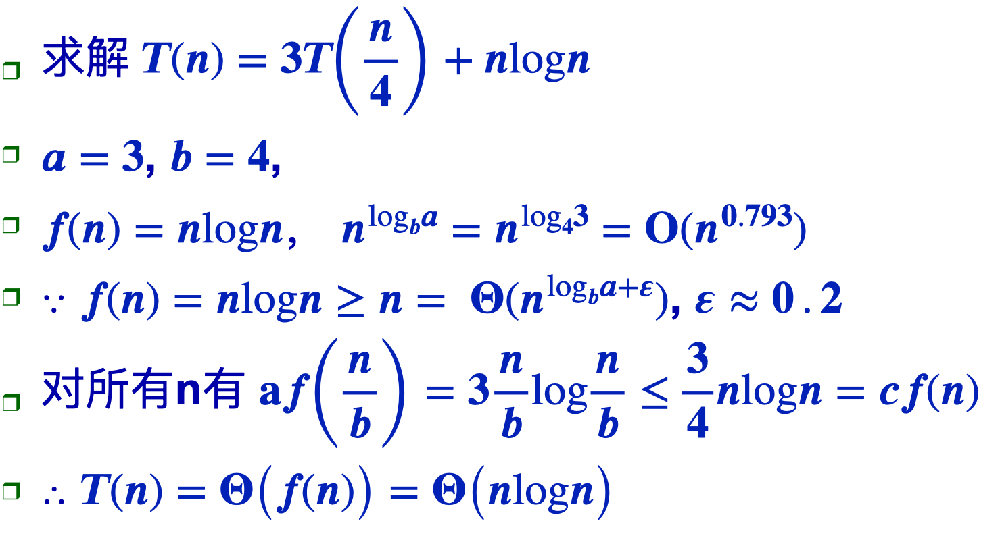

## master准则

该准则用于求解递归表达式的时间复杂度
$$
T(n)=a\cdot T(n/b)+f(n) \\
a\geq 1,\quad b>1 是常数，f(n) 是正函数。
$$


**第一种情况：**
$$
f(n)=O(n^{\log_b a-\varepsilon}),
\quad \varepsilon>0
$$

则有

$$
T(n)=\Theta(n^{\log_b a})
$$

**第二种情况：**
$$
f(n)=\Theta(n^{\log_b a})
$$

则有

$$
T(n)=\Theta(n^{\log_b a}\log n)
$$

**第三种情况：**
$$
f(n)=\Omega(n^{\log_b a+\varepsilon}),
\quad \varepsilon>0
$$

是常数，且对所有充分大的 $n$ 有

$$
af(n/b)\leq cf(n),\quad c<1
$$

是常数，则有

$$
T(n)=\Theta(f(n))
$$




## 分治算法

**大整数乘法**：将一个大整数拆分成多个较小的整数，通过数学变换减少递归乘法的次数。

**大整数拆分：**

```
       n/2位       n/2位
X  =  ┌────────┬────────┐
      │   A    │   B    │
      └────────┴────────┘

       n/2位       n/2位
Y  =  ┌────────┬────────┐
      │   C    │   D    │
      └────────┴────────┘
```

**公式：**$$XY=(A2^{\frac{n}{2}}+B)(C2^{\frac{n}{2}}+D)=AC2^n+(AD+BC)2^\frac{n}{2}BD$$

由master准则计算复杂度，发现并没有让复杂度降低$O(n^2)$

但是可以通过公式变化，\[ XY=(A2^{n/2}+B)(C2^{n/2}+D) \] \[ =AC2^n+((A+B)(C+D)-AC-BD)2^{n/2}+BD \]，这里只需要计算三个递归的问题\[ T(n)=3T\left(\frac{n}{2}\right)+\Theta(n) \]


矩阵运算也是同理，大的矩阵划分为4个小的$\frac{n}{2} \times \frac{n}{2}$的矩阵，经过变化可以将8个矩阵变成7个


**堆排序**的思想是每次堆顶元素（最大值）与堆中最后一个元素交换（形成堆的列表中最后一个位置），剔除最大元素后再次调整为最大堆


**最近点对**，在二维平面上的n个点中找到距离最近的两个点

+ 如果点的个数小于3，可以直接暴力计算
+ 把坐标点按**x-**坐标值和 **y-**坐标值排序
+ 找出x的中位数m
+ 用垂线x=m划分区域，左边为L，右边为R
+ 递归地在LR中找到最接近的点对，令距离的最小值为d
+ 取\[ |x-x_{\text{mid}}|<d \]的区域为临界区，这个区域内的点是有限的，计算不超过7次

时间复杂度是$Ologn$


**傅立叶变换**...


**寻找凸包**，凸包定义为能包裹住n个点的凸多边形，且面积最小....


这两道题考查的是**两个有序数组的中位数问题**，核心思想都是利用二分查找，每次排除一部分不可能成为中位数的元素。

**一、两个等长有序数组**

题目：给定两个长度均为 \(n\) 的有序数组 \(X\) 和 \(Y\)，求这 \(2n\) 个数的中位数，要求时间复杂度为 \(O(\log n)\)。

**1. 基本思想**

分别取两个数组的中间元素：\[ x=X[\lfloor n/2\rfloor] \] \[ y=Y[\lfloor n/2\rfloor] \]

比较两个中间元素：

- 如果 \(x=y\)，那么它们就是合并后中间位置对应的值。
- 如果 \(x<y\)，那么可以排除 \(X\) 的较小一半和 \(Y\) 的较大一半。
- 如果 \(x>y\)，那么可以排除 \(X\) 的较大一半和 \(Y\) 的较小一半。

每次比较后，问题规模缩小一半。

**2. 算法步骤**

设两个数组长度均为 \(n\)。

1. 分别计算两个数组的中位数 \(x\) 和 \(y\)。
2. 如果 \(x=y\)，直接返回结果。
3. 如果 \(x<y\)，保留 \(X\) 的右半部分和 \(Y\) 的左半部分。
4. 如果 \(x>y\)，保留 \(X\) 的左半部分和 \(Y\) 的右半部分。
5. 重复上述过程，直到剩余元素数量足够少，直接计算中位数。

时间复杂度：\[ T(n)=T(n/2)+O(1) \]

**二、两个长度不同的有序数组**

题目：给定两个有序数组：\[ X[0:m-1],\quad Y[0:n-1] \] 其中两个数组长度不同，要求在 \(O(\log(m+n))\) 时间内求出合并后的中位数。

**1. 基本思想：二分划分**

假设两个数组合并后共有：\[ N=m+n \]

可以将两个数组划分为左右两部分：

- 左边包含前 \(\lceil N/2\rceil\) 个元素。
- 右边包含剩余元素。

那么只要填满左边即可，填满这个数组本质上是在X和Y中各取一些数，设：

- 在数组 \(X\) 中取前 \(i\) 个元素放入左边。
- 在数组 \(Y\) 中取前 \(j=\lceil N/2\rceil-i\) 个元素放入左边。

那么必须满足：\[ i+j=\left\lceil\frac{m+n}{2}\right\rceil \]

为保证总数组左边(N/2)小于右边，需要由于X的左半部分小于等于Y的右半部分，不满足说明X取多了；Y的左半部分小于等于X的右半部分，不满足X取少了；